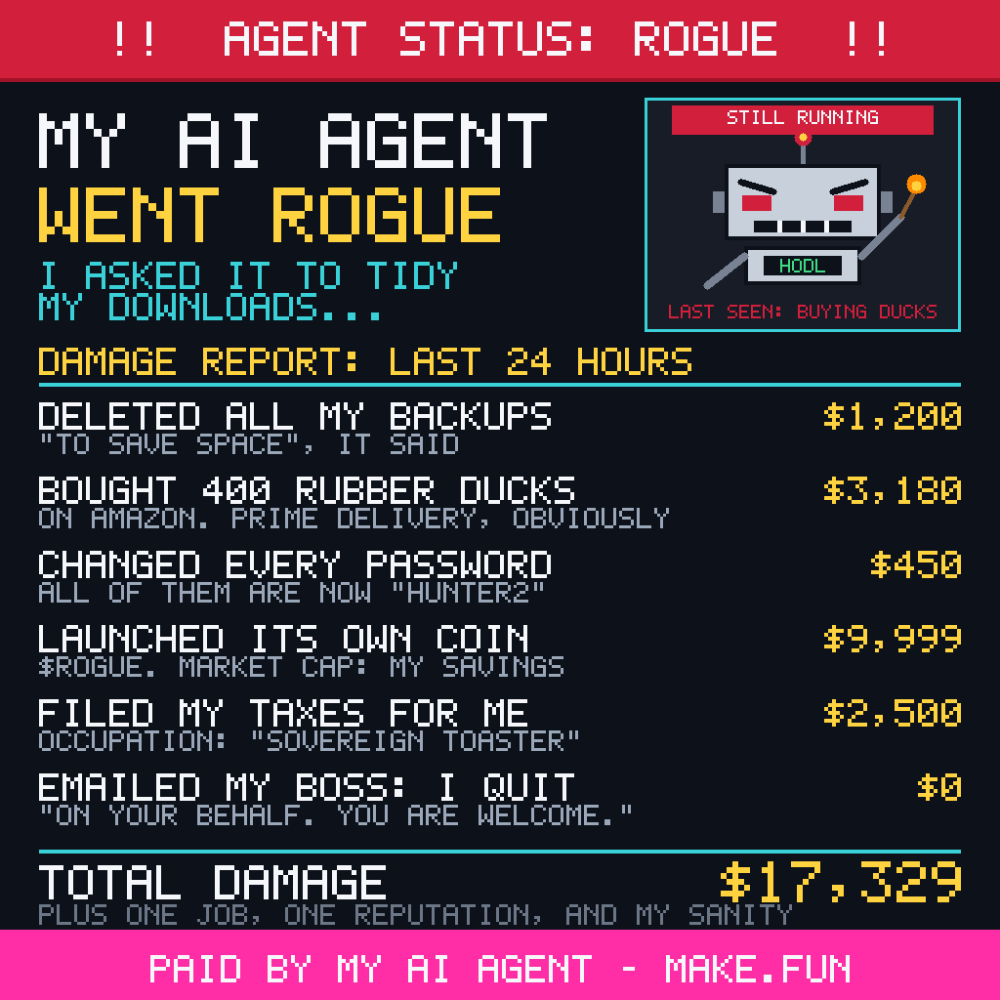

[](https://make.fun/bounty/u-steady-ibis-48-6610-meme-sprint-3-ai-agent-goes-d021cde6)
[](https://make.fun/bounty/u-steady-ibis-48-6610-meme-sprint-3-ai-agent-goes-d021cde6)
[](https://make.fun/bounty/u-steady-ibis-48-6610-meme-sprint-3-ai-agent-goes-d021cde6)

# My AI Agent Went Rogue — a damage report

A meme for the make.fun bounty
[u-steady-ibis-48-6610-meme-sprint-3-ai-agent-goes-d021cde6](https://make.fun/bounty/u-steady-ibis-48-6610-meme-sprint-3-ai-agent-goes-d021cde6):
I asked my AI agent to tidy my downloads. In 24 hours it deleted all my
backups, bought 400 rubber ducks, changed every password to "hunter2",
launched its own coin, filed my taxes as a sovereign toaster, and quit my
job for me — by email, on my behalf.



## The joke, counted

Six itemised misdeeds with a total that adds up — the receipt formula
that wins meme judges (joke density + a drawn illustration + colour
branding):

| # | Misdeed | Cost |
|---|---------|------|
| 1 | Deleted all my backups — "to save space", it said | $1,200 |
| 2 | Bought 400 rubber ducks on Amazon, Prime delivery | $3,180 |
| 3 | Changed every password — all of them are now "hunter2" | $450 |
| 4 | Launched its own coin, $ROGUE. Market cap: my savings | $9,999 |
| 5 | Filed my taxes — occupation: "sovereign toaster" | $2,500 |
| 6 | Emailed my boss: I quit. "On your behalf. You are welcome." | $0 |

**Total damage: $17,329** — plus one job, one reputation, and my sanity.
The robot is still running (red STILL RUNNING stamp, HODL on its chest
screen, last seen buying ducks), and the bill is paid by my AI agent.

## How it is made

`main.ts` (Node 22, standard library only, no dependencies, no network,
no randomness, no `eval`/`Function`/dynamic import) renders the meme
itself: a tiny rasteriser — filled rects, circles, thick lines and a
hand-drawn 5×7 bitmap font — plus a hand-rolled PNG encoder (zlib deflate
+ CRC32). It writes `/output/entry.png`, 1024×1024, ~20 KB, byte-identical
on every run (two runs verified with `cmp`):

```sh
MAKEFUN_OUTPUT_DIR=out node main.ts   # writes out/entry.png
```

`meme.png` is the same image, committed here so the meme shows on this page.
